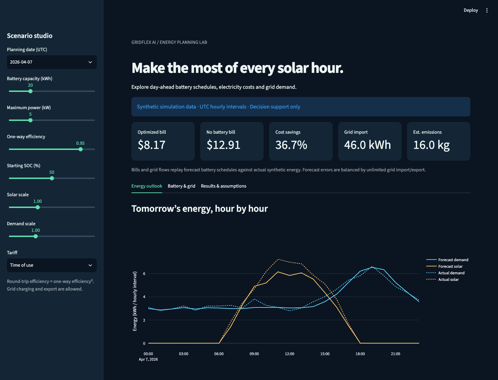

# GridFlex AI ☀️

Day-ahead renewable energy forecasting and battery scheduling for a simulated solar-powered building. Compare no storage, a rule-based battery, and a linear-programming schedule in an interactive Streamlit dashboard.

**All data and results are synthetic simulations.** This is a research/portfolio MVP, not a physical grid controller or field deployment.

## Quick start

Use **Python 3.14** (the version tested with the pinned dependency set).

```bash
python3.14 -m venv .venv
source .venv/bin/activate
python -m pip install -r requirements.txt
python -m pytest -q
python -m scripts.run_experiment
streamlit run app.py
```

Open http://localhost:8501. No API keys, accounts, or external data downloads are needed after installing dependencies. On Windows, activate with `.venv\Scripts\activate`.



## What it does

- Generates 120 reproducible days of hourly demand, solar, tariffs and assumed emissions intensity.
- Trains a random forest and evaluates it against previous-day persistence using a chronological 96-day/24-day split.
- Solves hourly battery dispatch with SciPy HiGHS, including losses, power limits, SOC limits and terminal SOC equality.
- Replays planned battery flows against actual synthetic energy; the grid balances forecast error.
- Compares strategies, shows forecasts, dispatch, SOC, tariffs and grid imports, and exports hourly CSV results.
- Includes numerical tests, a Streamlit interaction test, and GitHub Actions CI.


## Measured example

Reproduce with `python -m scripts.run_experiment`: seed **42**, **120 synthetic days**, **24 held-out days**, default 20 kWh / 5 kW battery, 95% one-way efficiency, starting and ending SOC 50%, operating bounds 10–90%.

| Strategy | Electricity bill (USD) | Grid imports (kWh) | Estimated operational emissions (kg) | Bill savings |
|---|---:|---:|---:|---:|
| No battery | 308.95 | 1,375.38 | 528.32 | 0.00% |
| Rule based | 210.09 | 1,158.01 | 405.84 | 32.00% |
| Optimized | 203.94 | 1,157.87 | 401.70 | 33.99% |

These figures describe one synthetic scenario, not expected real-world savings. Cost and emissions are distinct objectives. Emissions are accounting estimates using assumed factors; they are not verified avoided emissions.

| Forecast | Target | MAE (kWh per interval) | RMSE (kWh per interval) |
|---|---|---:|---:|
| Random forest | Load | 0.2169 | 0.2731 |
| Previous day | Load | 0.3844 | 0.4925 |
| Random forest | Solar | 0.3992 | 0.7523 |
| Previous day | Solar | 0.5000 | 0.9981 |

The saved run found no simultaneous battery or grid flows; maximum balance residual was below 1e-14 kWh. Runtime and complete precision results are in [reports/experiment.json](reports/experiment.json), [forecast_metrics.csv](reports/forecast_metrics.csv), and [strategy_comparison.csv](reports/strategy_comparison.csv). Each report is generated by the experiment, not manually asserted.

## Data and forecast protocol

`data/synthetic_hourly.csv` is generated by `src/data.py`, not measured data. Timestamps are UTC interval starts. Load combines a base load, weekday effect, evening peak and random noise. Solar combines a fixed 06:00–18:00 daylight envelope and random daily clouds. This deliberately simple generator does not model geography, daylight saving time, physical panel orientation or seasonal daylight variation.

Inputs include energy (kWh per interval), import/export price (USD/kWh), cloud fraction and assumed grid intensity (kg CO2e/kWh). Timestamps must be unique, continuous and hourly; numeric inputs must be finite/nonnegative and export prices cannot exceed import prices.

Forecasts use hour sine/cosine, weekday and previous-day load/solar. They never use future actual cloud cover. The model is trained once on the first 96 days; each held-out day uses only prior observations available at its midnight origin. The persistence baseline uses the previous day's same hour. UI scaling applies to both the predictions and actual profiles after forecasting. Battery comparisons use the random forest forecast; no perfect-foresight dispatch is mixed into the published comparison.

## Battery model and comparison fairness

For each interval, the optimizer chooses charge `c`, discharge `d`, import `i`, export `e`, and end-of-interval SOC `s`:

```text
minimize sum(buy_price*i - sell_price*e + 0.00001*(c+d))
solar + discharge + import = load + charge + export
s[t+1] = s[t] + eta*c[t] - d[t]/eta
min_fraction*capacity <= s <= max_fraction*capacity
0 <= c,d <= power_kw*dt_hours
initial SOC = terminal SOC
```

This version supports one-hour data only and explicitly rejects other interval durations; power bounds still multiply by `dt_hours`. Efficiency is one-way; the default round-trip efficiency is 90.25%. Displayed bills exclude the small throughput penalty. Grid charging and unlimited grid export are allowed. All surplus is exported; curtailment and solar self-consumption are not reported because source attribution is not modeled.

A pure LP does **not** enforce charge/discharge or import/export exclusivity. Positive cycling cost and losses discourage simultaneous flows; the validator detects and reports them rather than claiming a mathematical guarantee. Energy balance, SOC transitions, bounds and terminal state are checked with numerical tolerance.

The rule baseline charges from surplus solar and discharges against demand, with a reachability reserve and terminal correction that can charge from the grid to restore starting SOC. Both battery strategies plan from the same forecast and finish with the same stored energy. Forecast battery flows are replayed unchanged on actual load/solar, with unlimited grid balancing. This makes comparisons transparent but omits real-time receding-horizon control and grid connection limits. Optimization on a forecast does not guarantee the lowest realized bill on every day.

## Dashboard

Choose a held-out date, battery capacity, power, efficiency, initial SOC, solar/load scale and flat/time-of-use tariff. The app includes five KPIs, actual-versus-forecast traces, charge/discharge and SOC, grid comparisons, tariff charts, a strategy table, constraint diagnostics and a CSV download.

Browser QA verifies chart rendering, tabs and the CSV control; screenshots are saved in `docs/`. The automated app test checks initial rendering and changing battery capacity to zero. Numerical tests cover disabled batteries, no solar, empty/full initial SOC, large solar, zero/flat prices, losses, hand-calculated arbitrage, invalid input and forecast leakage.

## Repository

```text
app.py                 Streamlit UI
src/data.py            Synthetic generation and input validation
src/forecast.py        Calendar/lag model and chronological evaluation
src/optimize.py        Battery configuration, LP, dispatch validation
src/baselines.py       No battery and terminal-aware rule baseline
src/evaluate.py        Forecast schedule replay and comparison
src/metrics.py         Bills, imports, exports and assumed emissions
scripts/run_experiment.py  Reproducible reports and dataset
reports/               Actual generated experiment results
tests/                 Numerical and dashboard tests
```

## Deployment

For an optional Streamlit Community Cloud deployment, connect this repository, select `app.py`, install `requirements.txt`, and select Python 3.14 if supported by the host. If the host cannot provide this Python version, regenerate and test a compatible dependency set first. No live deployment URL is claimed by this repository.

## Limitations and next steps

Synthetic data cannot establish field performance. No battery aging, demand charges, grid power limits, network constraints, marginal emissions, capital cost or investment returns are modeled. The fixed daylight and calendar-lag forecast are intentionally modest. Next steps are licensed measured energy data, actual day-ahead weather forecasts, multi-day control and mixed-integer exclusivity constraints.

## Learning notes

This implementation demonstrates how battery losses and terminal SOC change fair comparisons, how chronological forecasting avoids future-data leakage, and why cost optimization and emissions accounting must be evaluated separately. Portfolio claims should cite the saved synthetic experiment; independently authored application materials remain the author's responsibility.

## License

MIT. See [LICENSE](LICENSE). Generated synthetic data and reports are included under the same license.
